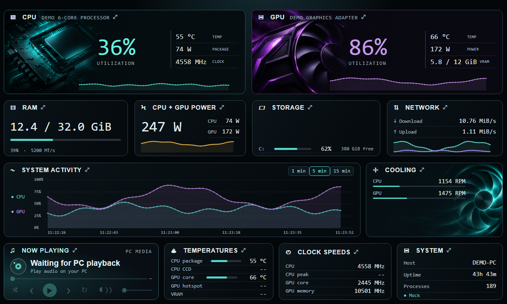
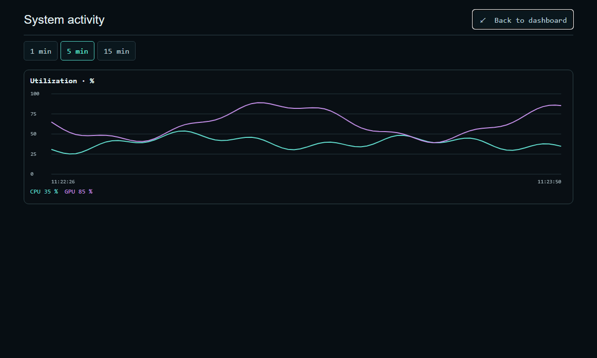

# PC Stats Dashboard

Turn a tablet into a live second screen for a Windows PC. A small Flask server collects hardware readings on the PC; the tablet displays them over Wi-Fi. The interface uses local HTML, CSS, JavaScript and canvas, with no frontend build step or external asset requests.

## Quick start on Windows

Install **64-bit Python 3.14** with the Windows Python launcher. Download and extract the repository, or clone it. Open PowerShell in the folder containing `server.py` and run:

~~~powershell
py -3.14 -m venv .venv
.\.venv\Scripts\python.exe -m pip install -r requirements.txt
.\.venv\Scripts\python.exe server.py --mock --local-only
~~~

Open **http://127.0.0.1:5000** on the PC. Mock mode uses fictional hardware names and animated sample readings. The pictures in this README were captured in this mode. Press **Ctrl+C** in the terminal to stop the preview.

## Monitor your own PC

~~~powershell
.\.venv\Scripts\python.exe server.py
~~~

After first-time setup, you can also double-click **Start Dashboard.bat**. Keep its window open. At startup the server prints the dashboard address for the current PC. Open that address on a tablet connected to the same trusted home network. In iPad Safari, choose **Share → Add to Home Screen** for a standalone view.

The server detects the host CPU, graphics adapter, installed memory, configured RAM speed, mounted drives and network counters at runtime. CPU/GPU temperatures, clocks, power and fan readings depend on what the drivers expose. NVIDIA readings use NVML; the optional hardware monitor below supplies additional sensors and supported AMD GPU readings. The dashboard displays one graphics adapter. Unsupported values appear as `--`.

| Option | Use |
| --- | --- |
| `--mock` | Explore the dashboard with simulated telemetry. |
| `--local-only` | Limit access to the machine running the server. |
| `--port 5050` | Choose another port if the default is occupied. |

## Enable temperature, fan and power sensors

1. Get [LibreHardwareMonitor](https://github.com/LibreHardwareMonitor/LibreHardwareMonitor/releases) and extract the release on the monitored PC.
2. Start it as administrator. Enable **Options → Remote Web Server → Run** and set its port to **8085**. Use a loopback address if the installed build offers one.
3. Open **http://127.0.0.1:8085/data.json** on the PC and confirm sensor data appears. Leave LibreHardwareMonitor running. Only the dashboard port needs to be reachable from the tablet.

## Using the dashboard

Tap a panel heading or its expand icon to see more detail. Use **Back to dashboard** or **Esc** to return. The main history graph stores up to 15 minutes of readings in memory. Select a time range and touch or drag across an expanded chart to inspect samples. The cooling view lets you isolate a fan. History builds while the server runs.

**PC music controls.** Run live mode as the Windows user playing the audio. The player uses Windows media sessions for song information, transport controls and available artwork. Browser music sessions take priority over game audio. For apps exposing only audio output, the dashboard can show an app name. Volume and mute control the PC's default output. The available track controls depend on the source app and queue.

**Optional YouTube track controls.** To expose available YouTube and YouTube Music navigation controls to Windows in Chrome, open `chrome://extensions`, enable Developer mode, click **Load unpacked**, and select the included `youtube-track-controls` directory. Reload the music tab and play a playlist or queue. This extension is optional for general monitoring.

## Connection and privacy

The default live server listens on all interfaces and has no login. Use it on a trusted private LAN. Devices that can reach it can see live system and media information and can issue supported playback commands. Keep the dashboard off public networks and avoid port forwarding. GitHub hosts the source and preview images; each user runs the server on their own PC.

If Windows Firewall blocks tablet access, use this command in an administrator PowerShell window on a trusted **Private** network. Substitute your chosen port if necessary.

~~~powershell
New-NetFirewallRule -DisplayName "PC Stats Dashboard" -Direction Inbound -Action Allow -Protocol TCP -LocalPort 5000 -Profile Private -RemoteAddress LocalSubnet
~~~

If the printed address belongs to a VPN or virtual adapter, run `ipconfig` and use the IPv4 address of the Wi-Fi or Ethernet adapter connected to the tablet's network. Check the page locally first, and check that guest Wi-Fi isolation is disabled if the tablet still cannot connect.

## Source layout

- `server.py` collects readings, serves the interface, and provides the stats and history endpoints.
- `media_bridge.py` connects the player to Windows audio and media sessions.
- `static/` contains the dashboard code and bundled panel artwork.
- `youtube-track-controls/` contains the optional Chrome extension.
- `docs/images/` contains mock-mode screenshots suitable for sharing.

Dependencies need internet access during installation. The dashboard itself runs locally.
